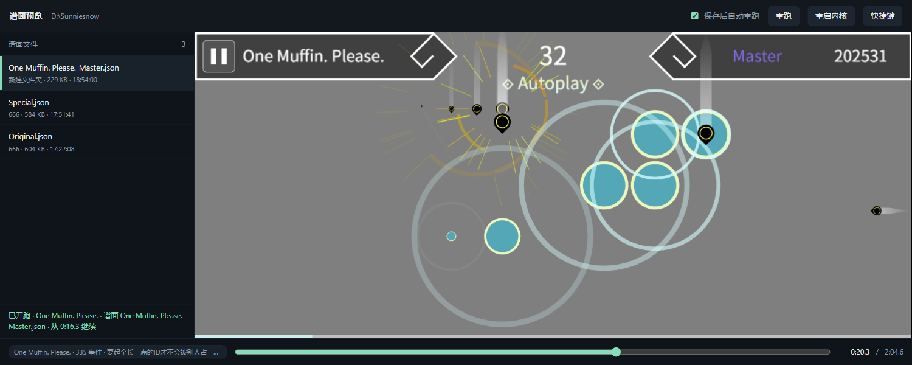

# Sunniesnow Chart Preview (PC)

While writing a Sunniesnow chart, keep this window open next to your editor: it watches the folder it lives in, and every time you save, the newest chart is reloaded and played immediately. No manual import, no switching charts.

English | [简体中文](README.md)



## Why

The official Sunniesnow web player makes you pick a chart file by hand and re-import it after every edit. Charting is a loop of "change one line, save, look". This tool collapses the last two steps: save and it replays, resuming near where you were.

## Features

- Watches the folder the executable sits in (subfolders up to depth 3), `.json` and `.ssc` only
- Reloads the newest chart on save; audio and artwork next to the chart are packed into the level automatically
- Timeline at the bottom: drag to seek, current / total time, chart info
- Reloads and jumps keep the play position so you can continue nearby
- Shortcuts: Space pause/resume, ←→ ±5s (Shift ±1s), ↑↓ switch chart, R reload, Home to start, F fullscreen, Esc exit fullscreen
- Resizing the window rebuilds the canvas at the stage size, so the picture is never stretched
- Long jumps restart the kernel at a percentage instead of being one giant seek, which would otherwise pile up tens of seconds of notes and effects on screen at once

## Quick start (prebuilt)

1. Put `SunniesnowPreview.exe` in an empty folder — that folder becomes the root
2. Drop chart JSON, its audio and artwork in there (or in a subfolder)
3. Run the executable, pick a chart from the list on the left
4. From then on, each save in your editor switches the window to the file you just saved

## Build from source

Requires Node.js 18+ on Windows.

```bash
npm install

# Copy the Sunniesnow web build into ./www (the folder should contain game/index.html)
npm run prepare-kernel -- D:\path\to\sunniesnow-web

npm start          # run
npm run build      # portable single-file exe in dist/
```

`www/` is a copy of the Sunniesnow kernel. It is not in this repository (large, and it belongs to the upstream project); put it in yourself as shown above. You can also point `WWW_DIR` at any kernel directory.

To work on the shell only, without packaging:

```bash
set WATCH_ROOT=D:\charts
set PORT=8125
npm run dev
# open http://127.0.0.1:8125/
```

## Root folder rules

| How it runs | Root folder |
| --- | --- |
| Portable exe | the folder containing the exe |
| Unpacked folder build | the parent of the program folder |
| From source | the project folder |

Packaging internals such as `resources` are skipped.

## Chart requirements

- `.json`: Sunniesnow chart JSON; an audio file (mp3 / ogg / wav / flac / m4a / opus / aac) must sit next to it; an image becomes the artwork
- `.ssc`: an already packed level file, used as is

## Known limitations

- **Seeking restarts the kernel**, so score and combo count from the landing point. Score is meaningless in a preview; this buys a clean frame. Keeping the score would mean literally seeking, which fills the screen with the notes and effects of everything skipped.
- If there are no notes after the landing point (dragging to the end of a chart, or an empty interlude), playback falls back to just before the last note and says so in the status bar.
- Seeking and resizing both restart the kernel, about 2–3 seconds, with a "loading" hint on screen.

## License

Released under **AGPL-3.0-or-later**, because the bundled Sunniesnow kernel is AGPL-3.0. Upstream author and attribution: see [NOTICE.md](NOTICE.md).
