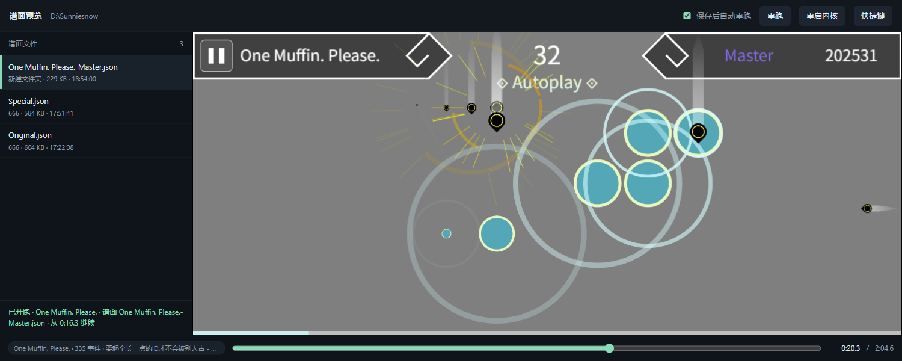

# Sunniesnow 谱面预览器（PC）

[English](README.en.md) | 简体中文

写 Sunniesnow 谱面时，一边在外置编辑器里改 JSON，一边在旁边窗口里实时看效果。
程序长驻监听「自己所在的那个文件夹」，你一保存，它就把最新谱面丢进 Sunniesnow 内核跑起来，不用手动导入、不用切歌。



## 它解决什么

Sunniesnow 官方网页端要手动选谱面文件、每改一次都得重新导入。写谱场景的节奏是「改一行——存一次——看一眼」，这个工具把后面两步压成一个：保存即重跑，位置还接着上次的播放点。

## 功能

- 监听程序所在目录（含子目录，深度 3），只认 `.json` / `.ssc`
- 保存后自动重跑最新那份谱面；同目录的音频、曲绘自动打进关卡包
- 底部时间轴：拖动定位、显示当前 / 总时长、当前曲目信息
- 重跑 / 跳转都保留播放位置，从附近接着看
- 快捷键：空格暂停继续、←→ ±5 秒（Shift ±1 秒）、↑↓ 切谱、R 重跑、Home 回开头、F 全屏、Esc 退全屏
- 窗口拉伸后画布按比例重建，不拉伸不变形
- 大跨度跳转按百分比重开内核，避免把中间几十秒的音符和特效一次性补出来糊满屏幕

## 快速开始（打包版）

1. 把 `SunniesnowPreview.exe` 放进一个空文件夹，这个文件夹就是「根目录」
2. 谱面 JSON、同名音频、曲绘放进去（或它的子文件夹）
3. 双击 exe，左侧列表里选一份谱面开跑
4. 之后编辑器每保存一次，窗口自动切到刚保存的那份

## 从源码构建

需要 Node.js 18+ 和 Windows。

```bash
# 1. 装依赖
npm install

# 2. 准备内核：把 Sunniesnow 的网页构建产物放进 ./www
#    （目录里应该有 game/index.html）
npm run prepare-kernel -- D:\path\to\sunniesnow-web

# 3. 本地跑
npm start

# 4. 打成单文件便携 exe（产物在 dist/）
npm run build
```

`www/` 是 Sunniesnow 内核的副本，仓库里不带它（体积大且属于上游工程），请按上面第 2 步自行放入。也可以设置环境变量 `WWW_DIR` 指到任意一份内核目录。

只想调外壳、不打包时：

```bash
# 左边窗口是浏览器，右边 watch 的目录随你改
set WATCH_ROOT=D:\charts
set PORT=8125
npm run dev
# 浏览器打开 http://127.0.0.1:8125/
```

## 目录即根目录

程序启动时这样判断「根目录」：

| 运行方式 | 根目录 |
| --- | --- |
| 便携版 exe | exe 所在文件夹 |
| 免解包的文件夹版 | 程序文件夹的上一级 |
| 源码运行 | 项目文件夹 |

扫描会跳过 `resources` 这类打包内部目录。

## 谱面要求

- `.json`：Sunniesnow 谱面 JSON，同目录必须有一份音频（mp3 / ogg / wav / flac / m4a / opus / aac），有图片就当曲绘
- `.ssc`：已经是打包好的关卡文件，直接读

## 已知限制

- **跳转会重开内核**，分数和 combo 从落点重新计。预览时分数没有意义，这样换来的是落点画面干净；如果只改播放时间保住分数，画面会堆满中间段的音符。
- 落点之后没有音符（比如拖到谱面尾部、或那段是空白间奏）时，会自动退到该处之前的最后一个音符附近起播，并在状态栏说明。
- 跳转和窗口尺寸变化都要重启内核，大约 2–3 秒，屏幕上有「内核解析中」提示。

## 许可证

本项目以 **AGPL-3.0-or-later** 发布，因为内置运行的 Sunniesnow 内核同样是 AGPL-3.0。上游作者与出处见 [NOTICE.md](NOTICE.md)。
